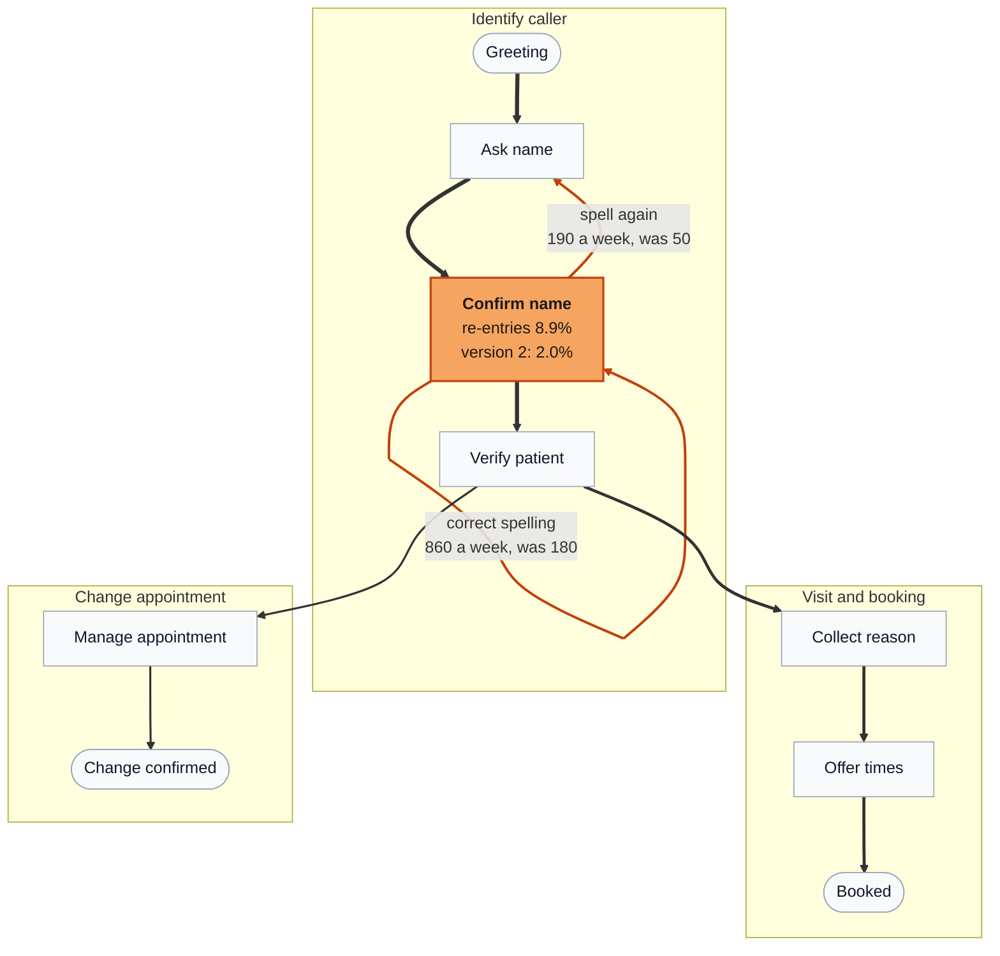
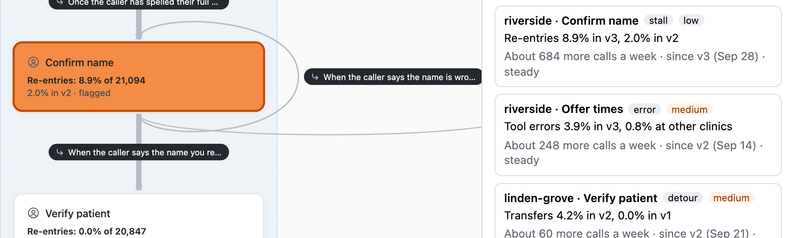
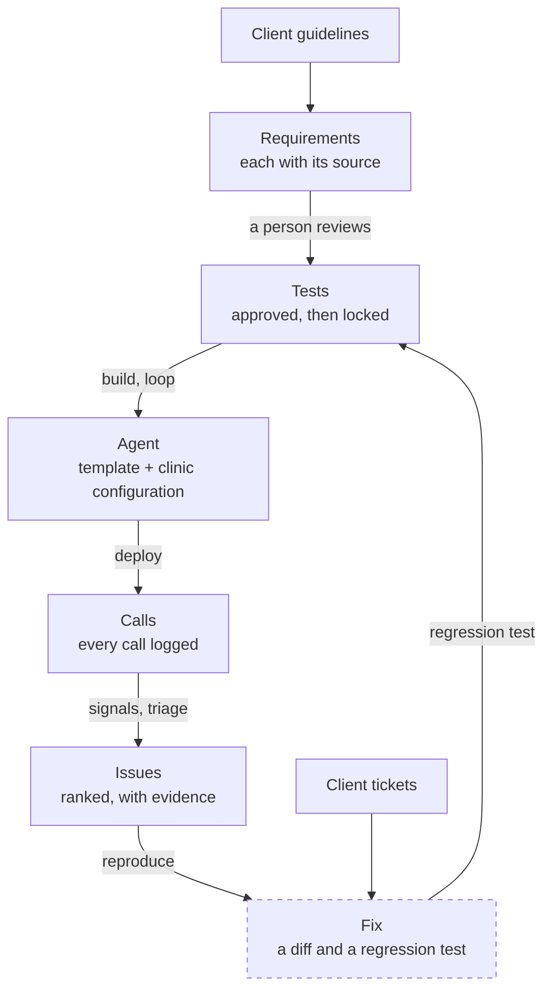

# Agent Copilot

**Build voice agents like software, watch them at scale.** Voice AI for healthcare scheduling, built for the Prosper challenge. An agent is a graph of nodes (conversation steps) and edges (transitions), stored as JSON and compiled into a live voice pipeline.

- **Phase 1, the editor:** edit the graph on a canvas and place a test call from the browser, watching the call move through the nodes.
- **Phase 2, the Copilot:** build an agent from a clinic's guidelines and check it with tests, then find the problems in its calls when nobody can listen to them.

**[Memo (PDF)](docs/memo/memo.pdf)** · **[Decisions (ADRs)](docs/adr/README.md)** · **[Working notes](docs/handoff.md)** · **[Hand-in tag](https://github.com/feliuserra/prosper-challenge-agent-copilot/tree/handin-2026-10-15)**

> **Hand-in, 15 October 2026.** The version handed in is the tag `handin-2026-10-15`. Start with the memo: the problem, what was built, what is designed but not built, and the results. Commits after the tag finish what the memo marks as designed: the Copilot UI, the judge on a sample, fix from an issue and the demo (#31 to #34).

## Finding a broken node in 50,000 calls a month

A call through one of these agents is not a free-form conversation: it is a path through a known graph. So every call is already a row in an event log, and problems show up as numbers on the graph, without a model reading a single transcript.

Here, Riverside's version 3 of the scheduling agent reads the caller's name back badly. Callers correct it again and again, so the Confirm name node re-enters itself far more than it did in version 2:



<sub>Riverside, version 3 against version 2, from the synthetic logs (`make synth`). Edge width is traffic, up to about 10,700 calls a week; the rare edge from Manage appointment back to Collect reason (about 115 a week) is left out. Only one node is tinted: the others are within noise of their baseline.</sub>

The detector flagged it the week version 3 went live, and `make detect` lists it first:

```text
5 issues for the week of Oct 5 to Oct 11 (85,433 calls in the logs, 3 clinics), most urgent first:

1. riverside, Confirm name: stall (low severity)
   Re-entries: 8.9% of 21,094 calls in version 3, 2.0% in version 2
   Re-entries: 8.9% of 21,094 calls in version 3, 2.4% in other clinics
   About 684 more calls a week; since version 3 (week of Sep 28), steady
   Examples: riverside-074516, riverside-074499, riverside-074493

2. riverside, Offer times: error (medium severity)
   Tool errors: 3.9% of 15,803 calls in version 3, 0.8% in other clinics
   About 248 more calls a week; since version 2 (week of Sep 14), steady
```

The second issue never changed between versions, so only the other clinics give it away. This is the same view in the editor, with the ranked issues on the right:



How it works, cheapest first:

1. **Signals on every call, no model.** For each node: entries, exits per edge, re-entries, long visits, hang-ups, transfers and tool errors. From the clinic's records: callbacks within 48 hours, bookings changed within a day, and duplicate patients (a new chart with an existing patient's birth date and phone under another name).
2. **Baselines make a rate mean something.** Each node is compared with itself in the previous version, and with the same template node at other clinics: agents come from one template, so the fleet is a baseline for free. A two-proportion test with a minimum effect keeps a busy agent from flagging tiny differences and a quiet one from flagging noise.
3. **Triage.** Flags are grouped by clinic, node and shape (stall, leak, detour, tool error, silent failure) and ranked by severity times the extra calls affected each week. The output is a short list per person, not a dashboard.

4. **A model judge on flagged calls plus a random sample** (#32), for the failures a path cannot show: a booking under the wrong name, an invented slot, a relative or a fake office manager helped. It answers a checklist item by item against the clinic's requirements, names the decisive turn and quotes the call; its issues join the ranked list, and the Calls tab opens a call at the quoted turn with the node selected. On 22 mock production calls from a deliberately weak agent (`backend/demo/`): 8 of 10 planted failures found, 2 false alarms, the decisive turn in the planted defect's node for all 8. Three of the planted failures were in calls tier 1 did not flag: only the random sample sends them to the judge. `make demo-seed` installs the calls and the judge's results; `make judge-eval` measures them.

## The loop

Coding agents work because code comes with a spec, tests they can run and bug reports with evidence. Voice agents have none of these. The Copilot creates them, then works the same loop. Dashed boxes are designed but not built yet.



- **Clinic rules are data, not prompts.** Appointment types, which provider does which, insurance coverage, required fields and the late-change fee live in a validated clinic configuration, and the tools enforce it: `book_appointment` refuses a visit the provider does not do, with a reason the model can act on.
- **Requirements are the spec.** The Copilot turns guidelines into numbered requirements, each citing the sentence it came from, plus questions for the client where the guidelines are silent, each with the safe default used meanwhile.
- **A person reviews tests, not prompts.** Tests are approved before the graph exists and then locked, so the Copilot cannot pass by editing them.
- **Exact checks first.** A small model plays the caller through a text runner that follows the voice runtime's rules. Tool calls, their arguments and order, and how the call ended are checked exactly; a model judge checks only what the agent said.

## Results

| Measure | Result |
| --- | --- |
| Reference suite (20 tests) on the agent the Copilot built for clinic A | 13 of 20 (target 18) |
| Deliberately broken agents caught by the tests | 12 of 15 |
| Judge agreement with reviewed labels | 32 of 32 |
| Planted defects found in the synthetic logs; false alarms | 6 of 6; none in 18 clinic-weeks |
| Spec step on clinic A's guidelines | 45 requirements, 25 tests, 5 client questions in 136 s |
| Cost | $0.09 a simulated test call, $0.38 a spec, $2.11 a build |

The memo has the misses, the limits (what text tests cannot see, what synthetic logs do not prove) and where detection stops working by rate and call volume.

## Quickstart

Requires **Python 3.11+**, [**uv**](https://docs.astral.sh/uv/getting-started/installation/) (it fetches a matching Python if needed) and **Node 24** (`frontend/.nvmrc`). Copy `backend/.env.example` to `backend/.env` and fill in `OPENAI_API_KEY` and `ELEVENLABS_API_KEY`. Then, from the repo root:

```bash
make install   # uv sync for the backend, npm ci for the frontend
make dev       # voice runner on :7860 + editor on :5173
```

Open `http://localhost:5173`: pick an agent, edit the graph, and press **Test call** in the toolbar, then **Call**. Allow mic access. The call uses the draft as it is in the editor, saved or not. `Ctrl+C` stops both processes. `make test` runs the backend and frontend tests; `make help` lists all targets.

```
browser mic  ->  ElevenLabs STT  ->  OpenAI LLM  ->  ElevenLabs TTS  ->  browser
```

`make run` starts the voice runner alone, with Pipecat's prebuilt client at `http://localhost:7860/client`, which calls the default agent (`backend/agents/prosper-scheduler.json`).

## Phase 2: what to run

Detection at scale makes no model calls:

```bash
make synth        # 85,000 synthetic calls, defects planted at known rates (6 s)
make detect       # the ranked issues (5 s)
make detect-eval  # recall, false alarms, where detection stops (40 s)
```

Then run `make dev`, open an agent and press **Call heatmap** on the canvas: the ranked issues appear on the right, and the graph is tinted by how far each node is from its baseline.

The tests and the Copilot call OpenAI with the key in `backend/.env` and cost money. Results are cached, so a rerun is free; `NO_CACHE=1` runs again. Setting `OPENAI_API_KEY=` on the command line is not a dry run: `backend/.env` wins.

| Command | What it does | Cost, uncached |
| --- | --- | --- |
| `make eval` | The 20-test reference suite (`backend/eval/clinic-a/`) against the hand-built reference agent | about $1.90 |
| `make eval MUTANTS=1` | The 15 broken agents against the tests built to catch them (needs `make eval` first) | about $3 |
| `make eval COPILOT=1 NO_LOOP=1` | The Copilot writes clinic A's spec from its guidelines, builds the agent from the template, and the reference suite runs on it | about $2.50 |
| `make spend` | The estimated spend so far, by day and source, from the spend log | free |

`make help` lists every target with its options.

## What is built

| Built | Designed, not built yet |
| --- | --- |
| Graph editor with stages, validation and undo; test calls with live node highlighting | Fix from an issue: reproduce, fix, keep a regression test (#33) |
| Clinic configuration, tool catalog and mock calendar; the scheduling template | A second clinic written by a person, held out until one final run |
| Text runner, test format, reference suite, mutants, judge calibration, spend log | |
| Spec step, build from the template and the loop; the Copilot panel to review, approve, watch it build and accept (#31) | |
| Synthetic call logs, signals, triage and the call heatmap | |
| Model judge on flagged calls plus a sample, and a calls inbox with each call's transcript (#32) | |

## Layout

| Path | Responsibility |
| --- | --- |
| `backend/bot.py` | The voice pipeline (WebRTC + ElevenLabs STT/TTS + OpenAI LLM). Runs the agent sent with the connect request, or the default agent. No graph logic lives here. |
| `backend/agent_builder/` | All agent-building code. `schema.py` = the declarative `AgentConfig` / `Node` / `Edge` contract; `validation.py` = every problem with an agent, as `{message, node, edge}` records; `builder.py` = `AgentBuilder`, which validates the JSON and compiles it into a Pipecat Flows graph. |
| `backend/composer_api.py` | The editor's agents API, served by the runner under `/composer` (list, get, save, validate, health). |
| `backend/agents/` | Agents **as data**, one JSON file each. `prosper-scheduler.json` is the scheduling template and the default agent; agents saved from the editor are gitignored. |
| `backend/copilot/` | The Copilot. `workspace.py` = one workspace per agent in `backend/workspaces/<id>/` (guidelines, spec, versions, test runs, proposals, call records; gitignored); `spec.py` and `build.py` = the spec step and the build; `api.py` = its API under `/copilot`. |
| `backend/clinic/` | The tool catalog, the mock clinic calendar and each clinic's configuration (`clinics/<id>.json`), which the tools enforce. |
| `backend/sim/` | The text runner: a simulated caller, the agent under the voice runtime's rules, the checks and the judge. |
| `backend/eval/` | Clinic A's guidelines, the reference suite and agent, the mutants and the judge labels; `make eval`. |
| `backend/detect/` | The synthetic call logs, the signals, the statistics and the triage behind `make detect` and the heatmap. |
| `docs/` | The memo, the [ADRs](docs/adr/README.md) (why each decision was made) and `handoff.md` (the working notes). |
| `frontend/` | The graph editor, the test-call panel and the call heatmap (Vite + React + TypeScript). In development Vite proxies `/composer`, `/copilot`, `/start`, `/sessions` and `/api` to the runner. |
